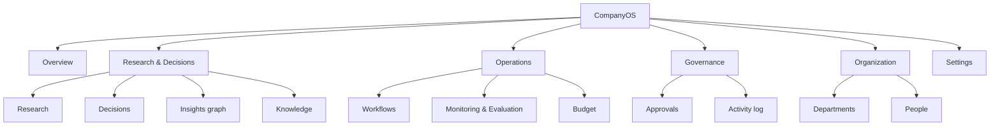
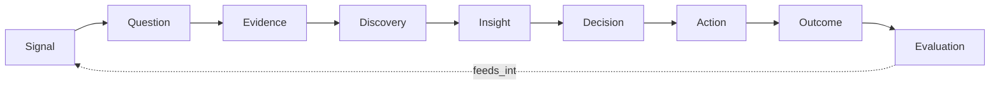
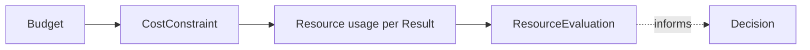
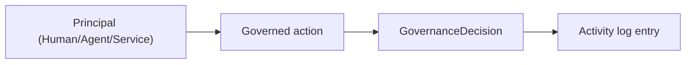
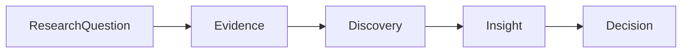

# Information Architecture

Status: DRAFT (2026-09-29, awaiting project-owner review)

## Application hierarchy

This mirrors the mockup's sidebar grouping (Workspace / Research & Decisions / Operations /
Governance / Organization / System) and `docs/architecture/ui-ux.md`'s screen inventory. Grouping
exists to answer "where would a user look for X," not to mirror the backend's package layout —
e.g. Knowledge sits under Research & Decisions because that's how a user encounters it (a Finding
auto-captures a Knowledge candidate, per `docs/audit`'s Phase 5 Slice 4 record), even though
`internal/kernel/knowledge` is architecturally a cross-cutting concern, not a Research subpackage.

## Main navigation

Left sidebar, persistent, grouped with section labels (not a mega-menu or top nav — the surface is
too deep for that). Overview is the only ungrouped top item (always first, always the default
landing screen). See [`design-system.md`](design-system.md) for the nav item component spec.

## Modules and sub-modules

| Module | Sub-modules | Screen inventory entry |
|---|---|---|
| Overview | — | `screen-inventory.md#overview` |
| Research & Decisions | Research, Decisions, Insights graph, Knowledge (library + review queue) | `screen-inventory.md#research` etc. |
| Operations | Workflows, Monitoring & Evaluation, Budget | `screen-inventory.md#workflows` etc. |
| Governance | Approvals, Activity log | `screen-inventory.md#approvals` etc. |
| Organization | Departments, People | `screen-inventory.md#departments` etc. |
| System | Settings (grouped: Organization, Research & Operations, System) | `screen-inventory.md#settings` |

## Screen relationships and cross-module navigation

The module boundaries above are navigational, not data-isolated — several screens deep-link across
modules, and this is intentional (traceability is a UX principle, not just an Insights-graph
feature):

- **Overview → Research**: "Open research →" on the latest-discovery card.
- **Overview → Decisions**: "View all →" on the needs-your-decision panel.
- **Research → Decisions**: a Discovery/Insight card that led to a Decision shows "View decision →".
- **Decisions → Insights graph** (planned, not yet in the mockup): a Decision's trace panel could
  deep-link to the same node pre-selected in the full graph — not built; see
  `ui-implementation-plan.md`.
- **Approvals ↔ Activity log**: every resolved Approval should eventually appear as an Activity-log
  entry (both read from `governance_decisions`/`approvals`, just at different granularity) —
  **not wired today**; flagged as an `OPEN QUESTION` below.
- **Budget → department rows**: no drill-down into a department's own Research/M&E screen yet;
  see `ui-implementation-plan.md`'s later phases.

## Cross-module relationship diagrams

**The organizational learning loop** (the product's central narrative, `product-overview.md`):

**Budget → Activities → Outcomes:**

**Users/Roles → Actions → Audit logs:**

**Research → Evidence → Decisions:**

## User entry points

- **Login → Overview** (default landing, no deep link).
- **Direct deep links** (planned, not all built): `/workflows/{id}`, `/objectives/{id}`,
  `/research/questions/{id}`, `/approvals/{id}` — each backed by a real `GET` endpoint per
  `ui-ux.md`'s screen inventory, so deep-linking is a UI-only addition, not a backend gap.
- **Realtime push** (`workflow:<id>` channel, existing) refetches rather than navigates — per
  `ui-ux.md` invariant 5, a push is a hint, never a navigation trigger.

## Global actions

- **New Workflow** (topbar, on the Workflow console and Overview).
- **Sign out** (sidebar footer).
- Notification bell (topbar) — present in the mockup, **not wired to anything real** (no
  notification backend exists); should render disabled/empty rather than implying unread state
  until one does.

## Search / filter architecture

- **Per-screen only today.** The Insights graph's type filter chips are the one real
  filter/search-adjacent control built so far (a search input is present in that screen's mockup
  but explicitly not wired — see `ui-ux.md`'s Insights-graph row).
- **OPEN QUESTION**: no global/cross-module search exists or is designed. Given the volume of
  Findings/Recommendations/KnowledgeItems a mature CompanyOS instance would accumulate, this is a
  real gap worth a dedicated design pass before Phase 10 is "done" — not scoped here to avoid
  inventing a search architecture the project owner hasn't reviewed.
- **OPEN QUESTION**: Approvals ↔ Activity log are not cross-linked (noted above) — resolving that
  is a smaller, more tractable near-term filter/navigation improvement than global search.
