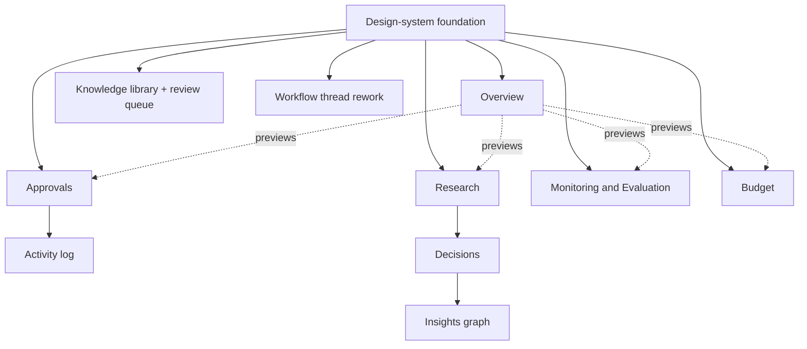

# UI Implementation Plan

Status: DRAFT (2026-09-29, awaiting project-owner review)

This is the execution detail underneath [`ROADMAP.md`](../../ROADMAP.md) Phase 10's slices — it
does not create a parallel plan or new slice numbers; it says how to build what those slices already
authorize (once `docs/architecture/ui-ux.md` is re-approved — Phase 10 Slice 0 is currently
unchecked, and nothing below should start before it is).

## 1. What should be implemented first

**Design-system foundation before any screen.** Set up `apps/web`'s token/component base
([`design-system.md`](design-system.md): colors, typography, spacing, radius, `Button`, `Card`,
`StatusBadge`/`StatusDot`, `NavItem`) before building a single real screen against it — every
screen in the mockup reused the same handful of primitives; building them once, correctly, avoids
five slightly-different Button implementations.

**Then, in `ROADMAP.md` Phase 10's own order** (this plan doesn't reorder its slices, only details
them):

1. **Slice 0** — re-approve `ui-ux.md` (documentation, not code; gates everything else).
2. **Slice 1** — Approval inbox. First real screen because it's the highest-frequency human action
   (per `product-overview.md`'s primary goals). Its backend endpoint (`GET /v1/approvals`,
   defaulting to `PENDING`-only) **landed 2026-09-29** — real port/repo/application/HTTP layers,
   integration-tested, live-verified — so this slice is now pure UI, no backend work remaining.
3. **Slice 2** — Knowledge library + review queue. Second because its backend is fully ready today
   (`ui-ux.md`'s inventory) and it reuses the Approval-card pattern Slice 1 just built.
4. **Slice 3** — Research/Decisions/M&E/Finance dashboards, **stopping the Insights graph at
   Decision** per its own documented limitation. Decisions' own backend also **landed 2026-09-29**
   (`GET /v1/objectives`, for the approved half — combined with Slice 1's `GET /v1/approvals` for
   the pending/declined half, per `data-ui-mapping.md`'s caveat that neither endpoint alone
   suffices). This is the largest slice; see phasing below for how to split it internally.
5. **Slice 4** — Activity log. Needs its own new backend endpoint (governance-decisions read) —
   sequence it after Slice 1 proves out the "plain-language + technical-detail toggle" pattern on
   a smaller surface first.
6. **Slices 5–7** — Objective authoring, Policy admin, AI provider registration — each explicitly
   needs its own design/backend pass per `ROADMAP.md`'s own text; not detailed further here.
7. **Slice 8** — Workflow thread visualization rework — can happen any time after the design-system
   foundation; has no dependency on the other slices.

## 2. Screen dependencies

Overview depends on *previewing* several other screens' data shapes, so building it fully polished
before Research/Approvals/M&E/Budget exist means either duplicating fetch logic or leaving preview
panels empty — **recommend building Overview's data-fetching last, its layout first** (ship it with
honest empty/loading states per [`ux-states.md`](ux-states.md) until the screens it previews land).

## 3. Components to build first

In order, per the dependency graph above: `Button`, `Card`/`PanelCard`, `StatusBadge`, `StatusDot`,
`ProgressBar`, `NavItem`, `PageHeader`, `StatCard` — these seven cover the majority of every screen
in [`screen-inventory.md`](screen-inventory.md). Then, per-slice: `ApprovalCard` +
`PlainLanguageDisclosure` (Slice 1), `TimelineNode` (Slice 3/Research), `GraphNode` +
`DetailPanel` + `FilterChip` (Slice 3/Insights graph), `ActivityRow` (Slice 4).

## 4. Existing components that can be reused

`apps/web` already has real, shipped components from Phase 1/3 (`WorkflowTrigger.tsx`,
`WorkflowExecutionTree.tsx`, the login/auth flow, `lib/companyd-client.ts`'s fetch wrappers). The
fetch-wrapper pattern and the existing Supabase session-token plumbing (`lib/session.ts`) should be
extended for every new endpoint, not reimplemented per screen. `WorkflowExecutionTree.tsx` itself
is explicitly *replaced*, not reused, by Slice 8 — but the realtime-refetch pattern it established
(`ui-ux.md` invariant 5) is reused by every future live-updating screen.

## 5. New components required

Everything listed in [`component-architecture.md`](component-architecture.md) that doesn't already
exist in `apps/web` — i.e. all of it; nothing in that document is a port of an existing `apps/web`
component, since the current app only has the Workflow console and login.

## 6. Data/API contracts required

Cross-referencing [`data-ui-mapping.md`](data-ui-mapping.md)'s remaining `BLOCKED` rows — the real
new backend work Phase 10 still depends on, distinct from pure-UI slices. Two items originally
listed here **landed 2026-09-29** and are removed from this list: `GET /v1/approvals` (Slice 1) and
`GET /v1/objectives` (Decisions' approved-history half, Slice 3) — both real port/repo/application/
HTTP layers, integration-tested against the real database, and live-verified. Remaining:

- A read endpoint over `governance_decisions` (Slice 4 — Activity log).
- The Decision→Action→Outcome→Evaluation linking fields `ui-ux.md`'s open question defers — needed
  before the Insights graph can extend past Decision, explicitly out of Slice 3's scope until
  resolved.

## 7. Screens that can start with mock data

Per [`ux-states.md`](ux-states.md)'s reconciliation rule (mock the *shape* of a real response,
never a metric with no real source): every screen whose backend already exists (`ui-ux.md`'s
"Backend ready" rows — now including Approvals, Decisions, Research, M&E, Budget, Knowledge
library/review) can be built against a typed mock matching the real endpoint's actual response
shape, then pointed at the live endpoint last. Screens whose backend is still `BLOCKED` (Activity
log, Settings) should mock against the *proposed* shape from section 6 above, clearly marked as
provisional in code comments, so the swap-in is mechanical once the endpoint exists.

## 8. Interactions that need backend support before they're real

- Approve/Decline (needs Slice 1's list endpoint to have something to act on at scale, though the
  `decide` endpoint itself already exists).
- Knowledge review's self-review disable (needs real Principal identity client-side —
  `permissions.md`'s open question).
- Any Settings form (needs literally any persisted config — none exists).
- Objective/mission direct authoring (Slice 5 — needs its own governed-Action design first).

## 9. Recommended implementation phases

| Phase | Scope | Depends on |
|---|---|---|
| **A — Foundation** | Design-system tokens + the 7 core components (section 3) | `ui-ux.md` re-approved (Slice 0) |
| **B — Approvals & Knowledge** | `ROADMAP.md` Slices 1–2 | Phase A; Slice 1's new endpoint |
| **C — Research, Decisions (to Decision), M&E, Budget** | `ROADMAP.md` Slice 3 | Phase A/B (reuses ApprovalCard pattern); the list-all-Objectives gap from section 6 flagged and resolved or explicitly descoped |
| **D — Activity log** | `ROADMAP.md` Slice 4 | Phase A; its own new endpoint |
| **E — Overview** | Wires previews into every screen Phases B–D shipped | Phases B, C, D (per the dependency note in section 2) |
| **F — Workflow thread rework** | `ROADMAP.md` Slice 8 | Phase A only — can run in parallel with B–E |
| **G — Everything past Decision in the Insights graph; Slices 5–7** | Each needs its own design pass per `ROADMAP.md`'s own text | Phase C; the Decision→Action linking design decision |

## 10. Definition of done, per phase

Every phase shares these baseline criteria before it's considered done, drawn directly from this
directory's other documents — not restated per phase below, only phase-specific additions:

- Matches [`design-system.md`](design-system.md) tokens exactly (no one-off colors/spacing).
- Every number/chart traces to a real endpoint per [`data-ui-mapping.md`](data-ui-mapping.md) — no
  shipped mock data (mocks are a build-time aid, per section 7, never shipped).
- [`ux-states.md`](ux-states.md)'s loading/empty/error patterns implemented, not skipped.
- [`accessibility.md`](accessibility.md)'s required fixes (focus states, `aria-label`s,
  `aria-expanded`, reduced-motion) present, not deferred as "polish later."
- [`responsive-design.md`](responsive-design.md)'s non-negotiable rule holds: no page-level
  horizontal scrollbar at any breakpoint tested.

Phase-specific additions:

- **A**: a components storybook/preview page (or equivalent) exists so B onward can build against
  real components, not copy-pasted markup.
- **B**: Approve/Decline round-trips against the real `POST /v1/approvals/{id}/decide` endpoint
  end-to-end, including the `409 CONFLICT` double-resolve case rendering sensibly, not crashing.
- **C**: the Insights graph's ancestor/descendant highlighting is computed from real fetched data,
  not hardcoded per the mockup's fixed example chain.
- **D**: the plain-language/technical-detail toggle pattern from B is reused, not reimplemented.
- **E**: every Overview panel independently loads/fails per `ux-states.md`'s per-panel rule.
- **F**: `WorkflowExecutionTree.tsx` is fully replaced (old flat-list code removed, not left dead).
