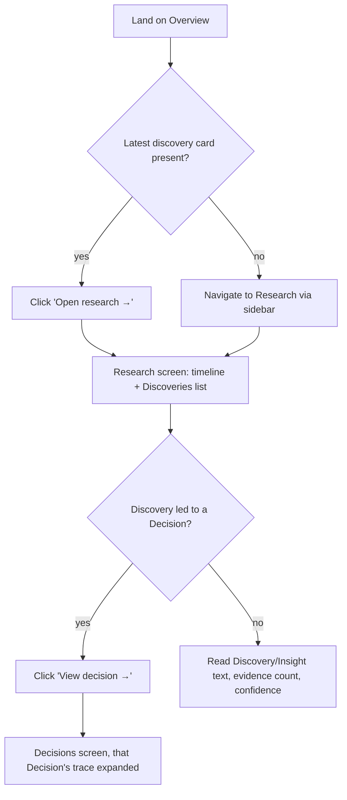
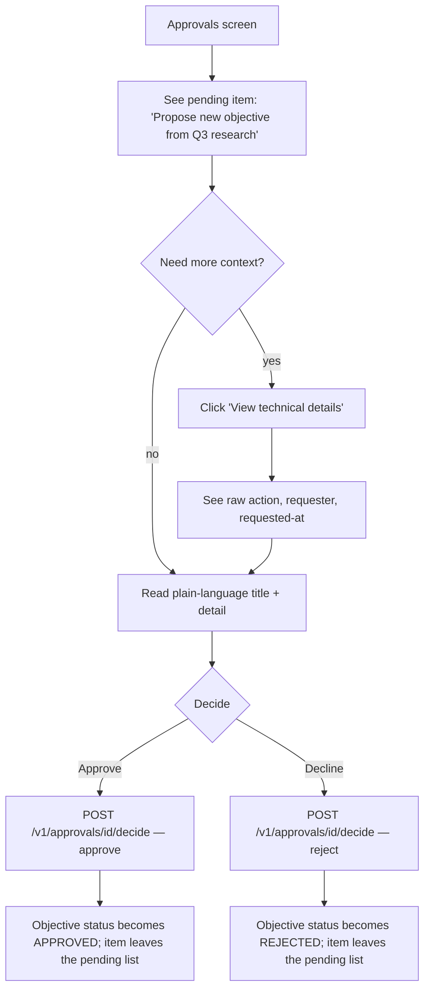
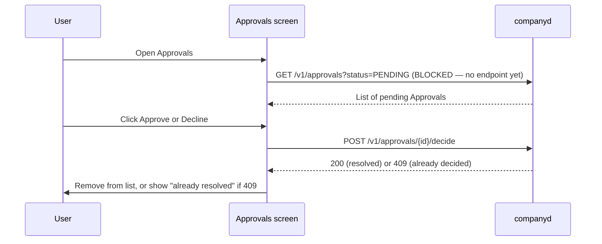
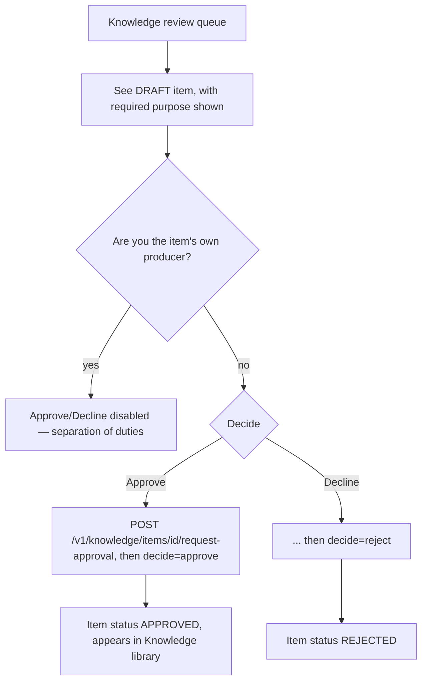
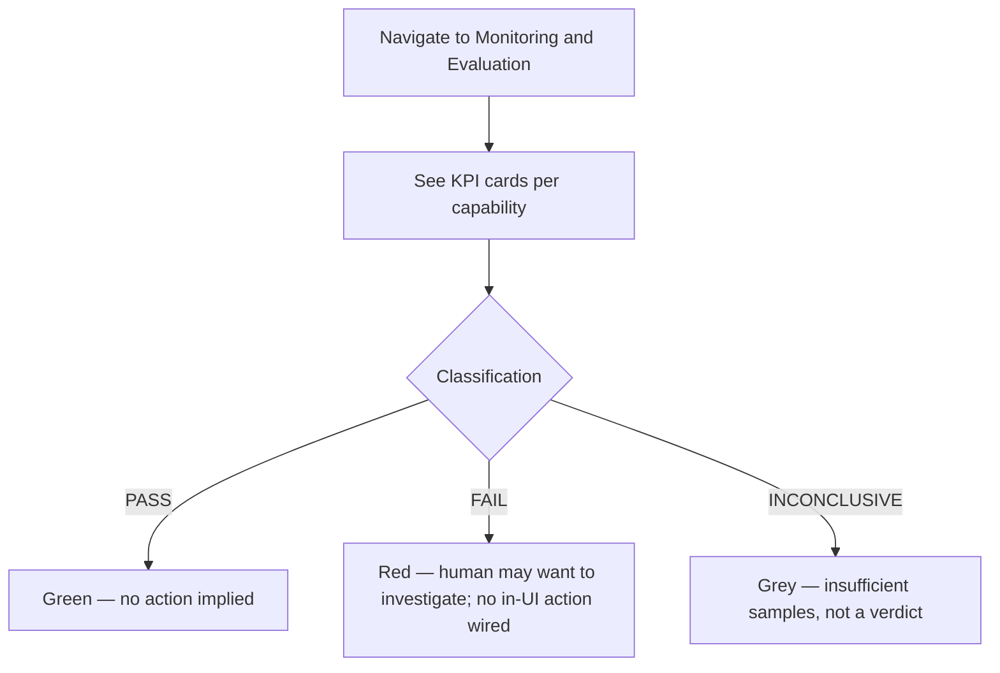
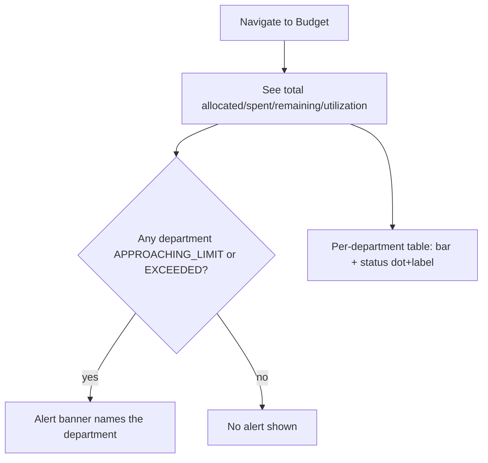
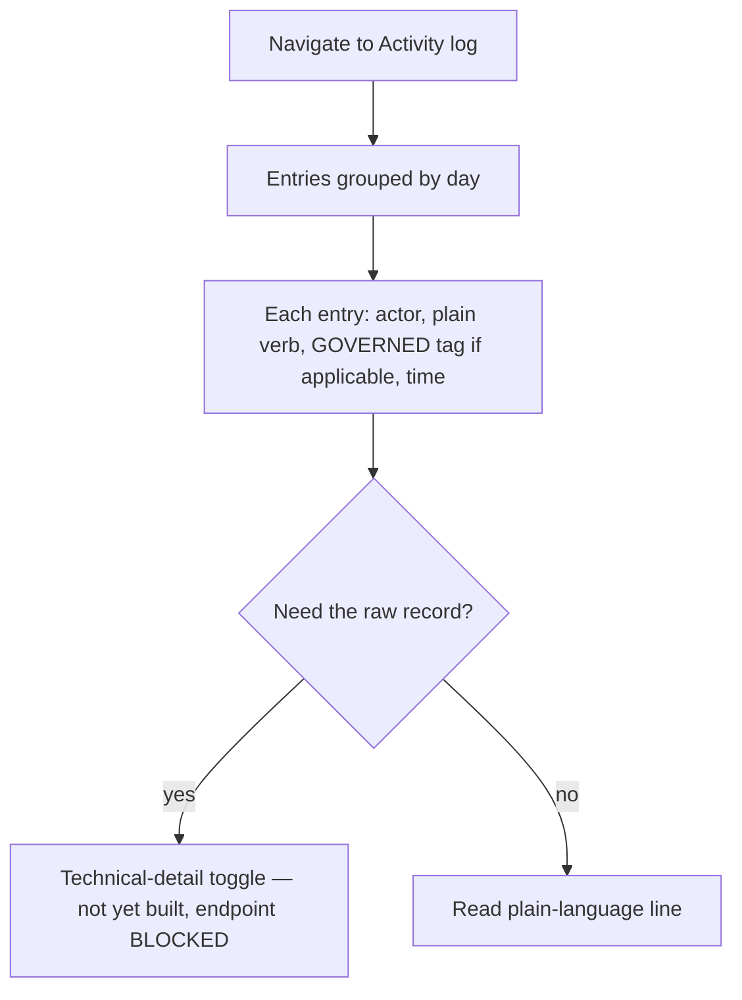
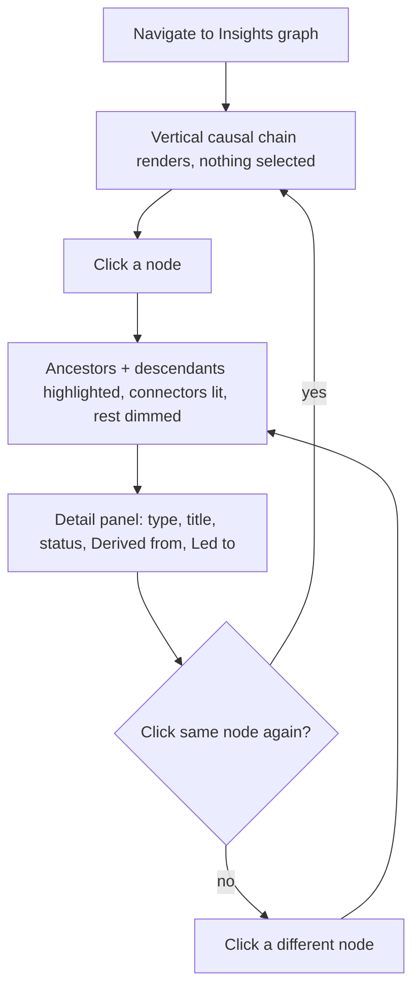

# User Flows

Status: DRAFT (2026-09-29, awaiting project-owner review)

Each flow below documents what the user is trying to accomplish, not just page-to-page navigation.
Flows are grounded in real backend actions per [`screen-inventory.md`](screen-inventory.md) —
where a step has no real backend yet, it's marked `BLOCKED` rather than drawn as if it works.

## Reviewing a research investigation

The primary Research flow today is **observation, not authoring** — a human doesn't submit signals
or write findings from this UI; Research/M&E/Finance are `AUTOMATIC`-autonomy Agent/Service actions
(`docs/departments/research.md`). The human flow is understanding what happened:

## Making a decision (resolving a proposed Objective)

Backend reality check: `ResolveApproval`'s reject branch is a real state transition for
`ApproveKnowledgeItem` (Knowledge) but a no-op for `ProposeObjective`/`CancelWorkflow` beyond
closing the Approval — a rejected Objective proposal simply never becomes a real Objective row
(`objective_propose.go`). The UI's "declined" messaging should say that plainly, not imply an
Objective was created and then rejected.

## Approving or declining any governed action (generic Approval flow)

Same shape as above, generalized — this is the one real interaction pattern every `REQUIRE_APPROVAL`
action shares (`CancelWorkflow`, `ProposeObjective`, `ApproveKnowledgeItem` today):

## Reviewing a Knowledge candidate

## Checking capability performance (Monitoring & Evaluation)

## Tracking budget and cost constraints

## Reviewing the activity/audit log

## Tracing a decision through the Insights graph

## Managing configuration/settings

`BLOCKED` — no persisted configuration exists anywhere in the backend today. The only honest flow
is: navigate to Settings, see every item marked unavailable. No further flow to document until a
concrete config-backed slice exists (see `ui-implementation-plan.md`).

## Flows deliberately not documented here

The original brief's list included "creating research questions," "adding sources/evidence,"
"recording discoveries," "creating findings," "creating actions," "recording achievements" as
human-initiated flows. None of these are human-initiated in the current backend — they're Agent/
Service actions under `AUTOMATIC` autonomy (`research.signal.submit` etc., all governed but not
gated on human approval). Documenting a human "Create Discovery" flow would describe a UI action
that has no endpoint to call. If human-authored research input becomes a real product requirement,
it needs its own backend design pass before a UI flow can be honestly documented here.
